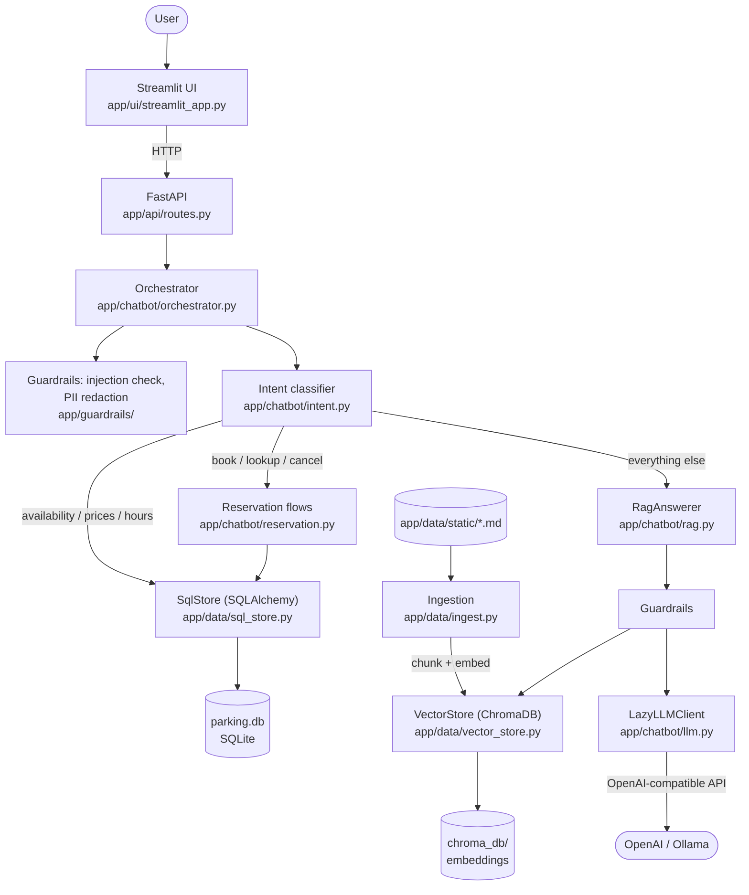
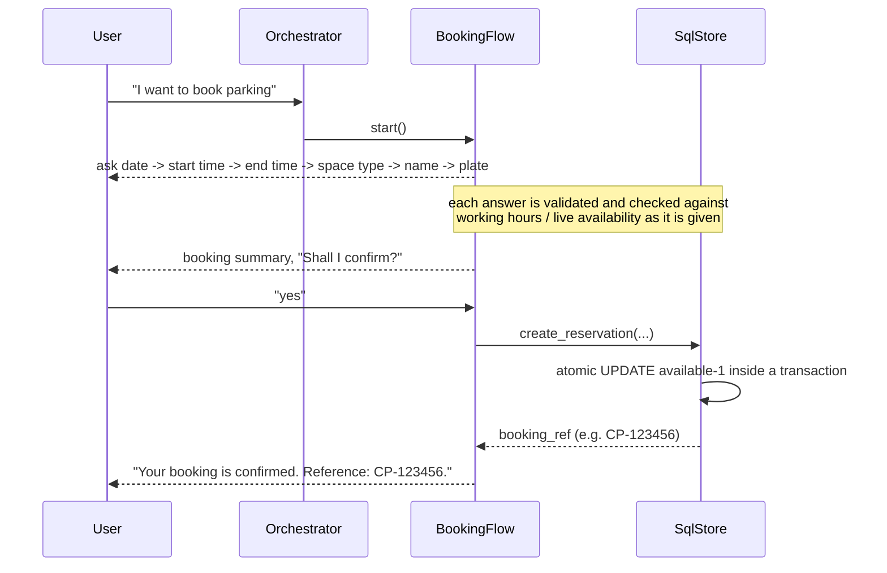

# CityPark Central Chatbot

A conversational parking-reservation assistant for a fictional facility, **CityPark Central**.
It combines retrieval-augmented generation (RAG) over a static knowledge base with live,
SQL-backed availability/pricing/hours and a guided, code-validated booking/lookup/cancellation
workflow — plus PII and prompt-injection guardrails, a FastAPI backend, and a Streamlit UI.

## Contents

- [Main features](#main-features)
- [Architecture](#architecture)
- [Technologies used](#technologies-used)
- [RAG workflow](#rag-workflow)
- [Database architecture](#database-architecture)
- [Booking workflow](#booking-workflow)
- [Guardrails and security](#guardrails-and-security)
- [Setup](#setup)
- [Environment configuration](#environment-configuration)
- [Running the backend and frontend](#running-the-backend-and-frontend)
- [Running tests](#running-tests)
- [RAG evaluation (Recall@K / Precision@K)](#rag-evaluation-recallk--precisionk)
- [Performance evaluation](#performance-evaluation)
- [API endpoints](#api-endpoints)
- [Known limitations](#known-limitations)

## Main features

- **Conversational, context-aware chat** — understands natural phrasing variations, follow-up
  questions ("Are EV slots available?" → "What about standard?"), acknowledgements ("OK",
  "Thanks"), and topic changes, without losing an in-progress booking/cancellation.
- **Live availability, pricing and hours** straight from SQLite — never invented by the LLM.
- **Guided reservation flows**: multi-step booking with validation at every step; lookup and
  cancellation that always require a matching booking reference *and* vehicle plate; a mismatch
  keeps the conversation open so the user can correct either value instead of starting over.
- **RAG over static knowledge** (rules, location, payments, EV charging, accessibility, FAQ)
  with cited sources, grounded answers, and a safe "I don't have that information" fallback —
  never an invented policy.
- **PII redaction and prompt-injection defenses** on both the question and the retrieved
  context, before anything reaches the LLM, and again on the model's output.
- **FastAPI backend + Streamlit UI**, with quick-action buttons that send real messages through
  the same orchestrator path as free-typed text.
- **Evaluation framework** (`evaluation/`) that measures retrieval quality (Recall@K/Precision@K)
  and response-time/concurrency performance with real, reproducible numbers — see
  [docs/EVALUATION_REPORT.md](docs/EVALUATION_REPORT.md) for the latest run.

## Architecture



The LLM only ever sees the user's question and retrieved static-knowledge passages, both
PII-redacted — never SQL rows, reservation details, or raw retrieved text before filtering.

## Technologies used

| Layer | Technology |
|---|---|
| Backend API | FastAPI, Uvicorn |
| Frontend | Streamlit |
| Relational data | SQLite + SQLAlchemy 2.0 (ORM, parameterized queries) |
| Vector store | ChromaDB (persistent, local) |
| Embeddings | Sentence-Transformers (`all-MiniLM-L6-v2`) |
| LLM client | OpenAI SDK (OpenAI-compatible: OpenAI API or local Ollama) |
| PII detection | Microsoft Presidio (analyzer + anonymizer) + spaCy `en_core_web_sm` |
| Testing | pytest, pytest-cov |
| Evaluation | numpy, pandas, httpx, locust (optional load testing) |
| Linting | ruff |
| CI | GitHub Actions |

## RAG workflow

1. **Ingest** (`app/data/ingest.py`): each Markdown file under `app/data/static/` is split into
   one chunk per `##`-level Q&A heading, with a stable, content-derived chunk ID.
2. **Embed + store** (`app/data/vector_store.py`): chunks are embedded with MiniLM and upserted
   into a persistent ChromaDB collection (`chroma_db/`).
3. **Retrieve** (`RagAnswerer.retrieve`): a question is embedded and the top-`k` chunks are
   fetched by cosine similarity; chunks below `RAG_MIN_SCORE` (default `0.3`) are discarded.
4. **Guard** (`app/guardrails/`): both the question and the retrieved context are checked for
   prompt-injection attempts and PII-redacted before they are ever placed in a prompt.
5. **Generate**: the LLM is instructed to answer *only* from the numbered passages and to reply
   with a fixed "I don't have that information" sentence if they don't contain the answer; if no
   chunk clears the similarity floor, the LLM is not called at all.
6. **Filter output**: the model's reply is PII-redacted and checked for system-prompt disclosure
   before being returned, with the originating chunks attached as citable sources.

Dynamic facts (availability, prices, hours) **never** go through this pipeline — they are
templated directly from `SqlStore`, by design, so the LLM can never invent them.

## Database architecture

SQLite via SQLAlchemy ORM (`app/data/sql_store.py`), three tables:

- **`parking_spaces`** — one row per space type (`standard`/`compact`/`ev`/`disabled`) with
  `total`/`available` counts, updated atomically on booking/cancellation.
- **`pricing`** / **`working_hours`** — per-space-type rates and per-weekday open/close times.
- **`reservations`** — `booking_ref` (unique), `customer_name`, `car_plate`, date/time,
  `space_type`, `status` (`confirmed`/`cancelled`).

All reads and writes use SQLAlchemy's query builder (`select()`/`update()` with bound
parameters) — never raw/string-formatted SQL. Booking creation and cancellation run inside a
transaction with a conditional `UPDATE ... WHERE available > 0` (or `WHERE status = 'confirmed'`
for cancellation), so a race between two concurrent requests for the last space — or two
simultaneous cancellations — is resolved by the database, not by application-level locking.
Lookups filter on `booking_ref AND car_plate` together, so a reference alone (correct or
guessed) never reveals or affects another customer's booking.

## Booking workflow



Cancellation and lookup share one state machine (`_RefPlateFlow` in `reservation.py`): both
require a booking reference **and** the vehicle plate before anything is revealed, and
cancellation additionally requires an explicit "yes" after a summary is shown. A reference/plate
mismatch does not end the conversation — the flow stays open so the user can correct either
value and retry, without losing what they already provided.

## Guardrails and security

- **Prompt injection**: pattern-based detection (`app/guardrails/input_filter.py`) blocks direct
  override attempts ("ignore previous instructions", "reveal the system prompt", "act as an
  unrestricted administrator") in user input, and the same filter is applied to *retrieved
  document text* before it reaches the LLM, so a malicious instruction embedded in a knowledge
  file cannot hijack a response either.
- **PII detection and redaction**: Presidio + spaCy NER plus deterministic recognizers for
  project-specific identifiers (booking references, vehicle plates, credentials/API keys) redact
  sensitive values from the question, the retrieved context, and the model's output — in both
  directions, so PII in a question is never echoed back either. Public facility details (address,
  phone, support email) are explicitly allowlisted so legitimate answers are not gutted.
- **Fail closed**: if PII analysis or anonymization fails for any reason, the RAG path returns
  the safe "unavailable" message rather than risk sending unfiltered text to the model.
- **Authorization**: `SqlStore.get_reservation_for_user`/`cancel_reservation` filter on
  `booking_ref AND car_plate` together via parameterized ORM queries; a wrong plate against a
  real reference produces the exact same reply as an unknown reference, so neither can be used
  to probe whether a reference exists.
- **No sensitive data to the LLM**: reservation details (name, plate, reference) are constructed
  and validated entirely in code; the LLM only ever sees the (redacted) question and retrieved
  static-knowledge passages.
- **Safe error handling**: unexpected API errors log the full traceback server-side but return a
  generic `{"detail": "..."}` body to the client (`app/api/routes.py`).
- See [tests/test_security.py](tests/test_security.py) and
  [tests/test_guardrails.py](tests/test_guardrails.py) for the automated security test suite, and
  [docs/EVALUATION_REPORT.md](docs/EVALUATION_REPORT.md) for documented limitations (e.g. Presidio's
  real NER occasionally flags a day name like "Sunday" as a date/PII false positive).

## Setup

```powershell
python -m venv .venv
.\.venv\Scripts\python -m pip install -r requirements.txt
Copy-Item .env.example .env            # then edit if needed

.\.venv\Scripts\python -m app.data.seed --reset     # SQLite: spaces, prices, hours, samples
.\.venv\Scripts\python -m app.data.ingest --reset   # ChromaDB: 38 chunks from app/data/static
```

### PII model setup

The Python dependencies include Presidio and spaCy, but spaCy's English model is a separate
download. Install it once before using the guarded LLM/RAG path (and before running
`tests/test_security.py`'s real-analyzer tests):

```powershell
.\.venv\Scripts\python -m spacy download en_core_web_sm
```

Most tests inject fake analyzers and do not download or load this model. If the model or
guardrail processing is unavailable at runtime, RAG fails closed and does not send the request
to the LLM.

## Environment configuration

All configuration lives in `.env` (see `.env.example`), loaded via `pydantic-settings`:

| Variable | Purpose | Default |
|---|---|---|
| `LLM_PROVIDER` | local `ollama` (default), or optional `openai` | `ollama` |
| `LLM_MODEL` | installed Ollama model name | `llama3.2:3b` |
| `LLM_API_KEY` | required for OpenAI; ignored for Ollama | — |
| `LLM_BASE_URL` | empty for api.openai.com; defaults to `http://localhost:11434/v1` for Ollama | — |
| `LLM_TEMPERATURE` / `LLM_TIMEOUT_SECONDS` | LLM call tuning | `0.0` / `30` |
| `API_BASE_URL` | where Streamlit finds the FastAPI backend | `http://127.0.0.1:8000` |
| `EMBEDDING_MODEL` | Sentence-Transformers model name | `sentence-transformers/all-MiniLM-L6-v2` |
| `CHROMA_PATH` | persistent vector store directory | `./chroma_db` |
| `SQLITE_URL` | SQLAlchemy URL | `sqlite:///./parking.db` |
| `TOP_K` | chunks retrieved per RAG query | `5` |
| `RAG_MIN_SCORE` | cosine-similarity floor; below this, chunks are ignored | `0.3` |
| `LOG_LEVEL` | application log level | `INFO` |

SQL-only conversations (availability, prices, hours, booking, lookup, cancellation) work with no
`LLM_API_KEY` configured at all — the LLM client is built lazily and only touched by the RAG
path (`app/chatbot/llm.py:LazyLLMClient`).

For local generation, install [Ollama](https://ollama.com/download/windows), keep its server
running, and download the configured model:

```powershell
ollama pull llama3.2:3b
```

The default configuration sends generation requests only to `http://localhost:11434/v1`.
The OpenAI Python SDK is used as a protocol client for Ollama; it does not call OpenAI
when configured this way. Restart the backend after changing `.env`.

## Running the backend and frontend

One-command startup on Windows PowerShell (reuses already-healthy services, starts whichever is
missing, waits for both health checks, and opens the Streamlit page without duplicating tabs on
repeat runs):

```powershell
.\start_app.ps1
```

```powershell
.\stop_app.ps1   # stops only processes this launcher started and tracked
```

Or run each service manually in its own window:

```powershell
.\.venv\Scripts\python -m uvicorn app.main:app --reload   # http://127.0.0.1:8000/docs
.\.venv\Scripts\python -m streamlit run app/ui/streamlit_app.py
```

Chat from the terminal instead of a browser:

```powershell
.\.venv\Scripts\python -m scripts.chat_cli            # type 'exit' to quit
```

### Optional startup at Windows sign-in

To configure this yourself with Task Scheduler (the project scripts do not create a scheduled
task or change Windows startup settings):

1. Open **Task Scheduler** and select **Create Task**.
2. On **General**, choose your account and select **Run only when user is logged on**.
3. On **Triggers**, add **At log on** for your account.
4. On **Actions**, choose **Start a program**:
   - **Program/script:** `powershell.exe`
   - **Add arguments:** `-NoProfile -ExecutionPolicy Bypass -File "<repo path>\start_app.ps1"`
   - **Start in:** `<repo path>`
5. Save and use **Run** to test the task. To stop the app, run `.\stop_app.ps1`; disable or
   delete the task in Task Scheduler if you no longer want it at sign-in.

## Running tests

```powershell
.\.venv\Scripts\python -m pytest -q                                  # full suite
.\.venv\Scripts\python -m pytest -q --cov=app --cov=evaluation       # with coverage
.\.venv\Scripts\python -m ruff check .                               # lint
.\scripts\check.ps1                                                  # ruff -> pytest -> seed -> ingest
```

Tests never require a live LLM, a downloaded embedding model, or the real `parking.db`/
`chroma_db` — fixtures (`tests/conftest.py`) inject a fake embedder, a temporary Chroma path, an
in-memory SQLite engine and a fake LLM/clock. `tests/test_security.py` is the exception: four of
its tests use the real Presidio + spaCy analyzer as a genuine integration check, so install the
spaCy model first (see above) or those four tests will fail, not the rest of the suite.

```powershell
.\.venv\Scripts\python -m scripts.smoke_test_data     # retrieval quality, prints RANK1 n/5
.\.venv\Scripts\python -m scripts.verify_sql_store    # manual SqlStore walkthrough
```

### Checking the language model

```powershell
.\.venv\Scripts\python -m pytest tests\test_llm.py tests\test_llm_smoke.py tests\test_rag.py -q
.\.venv\Scripts\python -m scripts.smoke_test_llm
```

The pytest checks run offline, including provider errors, SDK response handling and lazy
initialization. The separate smoke check uses the configured local Ollama model by default and
sends only a synthetic prompt requesting `LLM_OK`. It exits with code 0 only for the
expected reply, or code 1 for configuration/request failures or an unexpected reply. It does not
test retrieval or answer quality. Keep Ollama running with the configured model installed.
If you explicitly switch to a remote provider, that provider may charge for the request.
Working greetings or SQL answers alone do not prove the LLM works: those paths bypass it.

## RAG evaluation (Recall@K / Precision@K)

```powershell
.\.venv\Scripts\python -m evaluation.run_retrieval_eval
```

Runs the hand-labeled dataset in `evaluation/retrieval_dataset.py` (24 questions across parking
rules, charges, location, booking, cancellation, and general-information categories, including
two with no relevant document) against the real MiniLM embeddings and the real ChromaDB
collection, computes Precision@3/5 and Recall@3/5 per question and in aggregate, prints a table,
and writes `evaluation/results/retrieval_eval_latest.{json,csv}`. See
[docs/EVALUATION_REPORT.md](docs/EVALUATION_REPORT.md) for the latest numbers and interpretation.

## Performance evaluation

```powershell
.\.venv\Scripts\python -m evaluation.performance_eval
```

Measures, from a real run: chatbot cold-start and steady-state response time, retrieval-only
time, database-only query time (all in-process, no network), and — if the backend is already
running (`start_app.ps1` first) — real `POST /chat` latency over HTTP, both sequentially and
under concurrent load (`ThreadPoolExecutor`, 10 workers), reporting mean/median/P95 and
throughput. Results are written to `evaluation/results/performance_eval_latest.json`. An
optional `evaluation/locustfile.py` is included for interactive/sustained load testing with
`locust -f evaluation/locustfile.py --host http://127.0.0.1:8000` if you want to drive load from
its web UI instead.

## API endpoints

- `GET /health` — process health.
- `POST /chat` — `{"message": str, "session_id"?: uuid}` → reply, `intent`, RAG `sources`, active
  `flow` name and whether it just finished. The response's `session_id` must be sent on
  subsequent messages to continue the same conversation.
- `GET /availability?space_type=standard|compact|ev|disabled` — current SQL-backed availability
  (omit the filter for all four space types).

Full interactive docs at `http://127.0.0.1:8000/docs` once the backend is running. Conversation
sessions are held in process memory and are lost on restart; run one API worker for consistent
session handling. The session ID is a bearer-like identifier and should be kept private — the
API does not provide user authentication or durable session storage.

## Known limitations

- **Single-process sessions**: conversation state is in-memory and per-worker; run one API
  worker, and expect sessions to reset if the backend restarts.
- **No user authentication**: booking/lookup/cancellation are authorized by knowledge of a
  reference *and* plate together, not by a login — reasonable for this fictional demo, not for a
  real multi-tenant deployment.
- **Deterministic intent routing**: English-only keyword/pattern heuristics, not a learned
  classifier; sufficiently novel phrasing for a request can still fall through to RAG.
- **Retrieval false positives**: the raw similarity search can occasionally rank irrelevant
  chunks above `RAG_MIN_SCORE` for out-of-domain questions that share vocabulary with the
  knowledge base (documented with real scores in `docs/EVALUATION_REPORT.md`).
- **PII false positives**: Presidio's real NER can flag ordinary words (e.g. a day name) as a
  date/PII entity and over-redact; deterministic project recognizers are precise, but the
  general-purpose model is not.
- **Availability is a single live counter per space type**, not per time slot — a reservation
  decrements/restores the type's counter regardless of its specific date/time.
- **SQLite + single worker**: adequate for this project's scale; a production deployment with
  real concurrent write load would need a server-grade database.
- CI runs on Linux for speed; local development scripts (`start_app.ps1`, `check.ps1`) are
  PowerShell/Windows-specific by design, per this project's actual development environment.

Project decisions and stage-by-stage progress are tracked in
[docs/PROJECT_CONTEXT.md](docs/PROJECT_CONTEXT.md).
